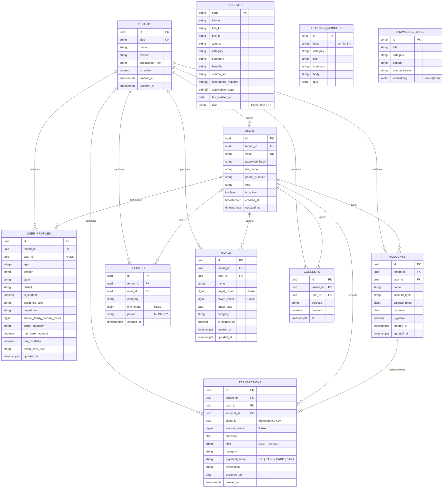

# FinSmart: Database Architecture & Technical Specification

> **System:** PostgreSQL 16 + `pgvector` Extension  
> **Compliance:** India DPDP Act 2023 • RBI Financial Guidelines • OWASP ASVS L2  
> **Design Paradigms:** Multi-Tenant Row-Level Security (RLS) • Integer Minor Units (Paise) • Declarative Rule DSL • Vector Embeddings

---

## 1. Architectural Philosophy & Invariants

FinSmart's database architecture is engineered around four non-negotiable principles:

1. **Zero Data Leakage (Row-Level Security)**:
   A single database instance serves multiple institutions (colleges, universities, public portals). Tenant isolation is enforced natively inside PostgreSQL using **Row-Level Security (RLS)** with `FORCE ROW LEVEL SECURITY`. Even if application code omits a `WHERE tenant_id = ...` filter, the database engine drops cross-tenant records at the storage engine level.
2. **Strict Money Invariant (Minor Units)**:
   To prevent IEEE 754 floating-point rounding errors, all financial amounts (transactions, account balances, budget limits, savings targets) are stored as `BIGINT` integer minor units (**Paise**; ₹1.00 = `100` paise). Decimal conversions occur solely at the UI edge.
3. **Offline-First Idempotency**:
   Transactions feature a composite unique constraint `(user_id, client_id)`. Client devices generate a UUID idempotency key before dispatching writes over spotty 2G/3G networks, preventing duplicate charges.
4. **Statutory DPDP Act 2023 Consent & Auditability**:
   Every personal data processing operation is audited in an append-only `consents` ledger. Complete data export (DSAR) and cascading erasure ("Right to be Forgotten") are supported at the relational schema level.

---

## 2. Entity-Relationship (ER) Diagram



---

## 3. Comprehensive Table Specifications

### 3.1. `tenants` (Institution Partitioning)
Stores educational institutions, colleges, and public portal domains.

| Column | Type | Constraints | Default | Description |
|---|---|---|---|---|
| `id` | `UUID` | `PRIMARY KEY` | `gen_random_uuid()` | Unique Tenant Identifier |
| `slug` | `TEXT` | `UNIQUE NOT NULL` | — | Subdomain slug (e.g. `navkis`, `rvce`, `public`) |
| `name` | `TEXT` | `NOT NULL` | — | Full legal name of college / institution |
| `domain` | `TEXT` | `NULL` | — | Domain alias (e.g. `navkis.edu.in`) |
| `subscription_tier` | `TEXT` | `NOT NULL` | `'standard'` | Service tier |
| `is_active` | `BOOLEAN` | `NOT NULL` | `true` | Soft-deactivation toggle |
| `created_at` | `TIMESTAMPTZ` | `NOT NULL` | `now()` | Registration timestamp |
| `updated_at` | `TIMESTAMPTZ` | `NOT NULL` | `now()` | Last modification timestamp |

---

### 3.2. `users` (Identity & RBAC)
User credentials, role assignments, and tenant bindings.

| Column | Type | Constraints | Default | Description |
|---|---|---|---|---|
| `id` | `UUID` | `PRIMARY KEY` | `gen_random_uuid()` | Unique User ID |
| `tenant_id` | `UUID` | `REFERENCES tenants(id) ON DELETE CASCADE` | — | College Tenant Boundary |
| `email` | `TEXT` | `NOT NULL` | — | Scoped email address |
| `password_hash` | `TEXT` | `NOT NULL` | — | Argon2id / Bcrypt password hash |
| `full_name` | `TEXT` | `NOT NULL` | — | Full display name |
| `phone_number` | `TEXT` | `NULL` | — | Contact phone number |
| `role` | `TEXT` | `CHECK (role IN ('student','faculty','college_admin','admin'))` | `'student'` | Scoped Role |
| `is_active` | `BOOLEAN` | `NOT NULL` | `true` | Account active state |
| `created_at` | `TIMESTAMPTZ` | `NOT NULL` | `now()` | Enrolment timestamp |
| `updated_at` | `TIMESTAMPTZ` | `NOT NULL` | `now()` | Profile update timestamp |

*Indexes & Constraints:*
- `UNIQUE (tenant_id, email)`: Allows users to exist across multiple colleges without collisions.

---

### 3.3. `user_profiles` (Demographic Scheme Profiling)
Stores socio-economic data evaluated by the government scheme eligibility rules engine.

| Column | Type | Constraints | Default | Description |
|---|---|---|---|---|
| `id` | `UUID` | `PRIMARY KEY` | `gen_random_uuid()` | Profile record ID |
| `tenant_id` | `UUID` | `REFERENCES tenants(id) ON DELETE CASCADE` | — | Tenant foreign key |
| `user_id` | `UUID` | `REFERENCES users(id) ON DELETE CASCADE UNIQUE` | — | User ownership foreign key |
| `age` | `INTEGER` | `CHECK (age >= 0 AND age <= 120)` | `NULL` | Age in years |
| `gender` | `TEXT` | `CHECK (gender IN ('male','female','other','prefer_not_to_say'))` | `'prefer_not_to_say'` | Gender identity |
| `state` | `TEXT` | `NOT NULL` | `'Karnataka'` | Domicile state |
| `district` | `TEXT` | `NULL` | — | Domicile district |
| `is_student` | `BOOLEAN` | `NOT NULL` | `true` | Student enrollment status |
| `academic_year` | `TEXT` | `NULL` | — | Year of study (e.g. `2nd Year`) |
| `department` | `TEXT` | `NULL` | — | Academic discipline (e.g. `CSE`) |
| `annual_family_income_minor` | `BIGINT` | `NOT NULL CHECK (>= 0)` | `0` | Household income in Paise |
| `social_category` | `TEXT` | `CHECK (IN ('GEN','OBC','SC','ST','EWS'))` | `'GEN'` | Caste / social category |
| `has_bank_account` | `BOOLEAN` | `NOT NULL` | `true` | Active bank account flag |
| `has_disability` | `BOOLEAN` | `NOT NULL` | `false` | Differently abled status |
| `ration_card_type` | `TEXT` | `CHECK (IN ('BPL','APL','AAY','None'))` | `'None'` | Welfare ration card classification |
| `updated_at` | `TIMESTAMPTZ` | `NOT NULL` | `now()` | Last profile verification |

---

### 3.4. `accounts` (Multi-Account Balances)
Supports household and student liquidity segregation (Bank, Cash, UPI Wallets).

| Column | Type | Constraints | Default | Description |
|---|---|---|---|---|
| `id` | `UUID` | `PRIMARY KEY` | `gen_random_uuid()` | Account ID |
| `tenant_id` | `UUID` | `REFERENCES tenants(id) ON DELETE CASCADE` | — | Tenant foreign key |
| `user_id` | `UUID` | `REFERENCES users(id) ON DELETE CASCADE` | — | Owner foreign key |
| `name` | `TEXT` | `NOT NULL` | — | Account name (e.g. `Canara Bank`) |
| `account_type` | `TEXT` | `CHECK (IN ('BANK','CASH','WALLET','SAVINGS'))` | `'BANK'` | Account modality |
| `balance_minor` | `BIGINT` | `NOT NULL` | `0` | Available balance in Paise |
| `currency` | `CHAR(3)` | `NOT NULL` | `'INR'` | ISO 4217 Currency Code |
| `is_active` | `BOOLEAN` | `NOT NULL` | `true` | Account active state |
| `created_at` | `TIMESTAMPTZ` | `NOT NULL` | `now()` | Creation timestamp |
| `updated_at` | `TIMESTAMPTZ` | `NOT NULL` | `now()` | Balance update timestamp |

---

### 3.5. `transactions` (Ledger Entries)
Append-friendly transaction log with offline client idempotency.

| Column | Type | Constraints | Default | Description |
|---|---|---|---|---|
| `id` | `UUID` | `PRIMARY KEY` | `gen_random_uuid()` | Transaction identifier |
| `tenant_id` | `UUID` | `REFERENCES tenants(id) ON DELETE CASCADE` | — | Tenant foreign key |
| `user_id` | `UUID` | `REFERENCES users(id) ON DELETE CASCADE` | — | User foreign key |
| `account_id` | `UUID` | `REFERENCES accounts(id) ON DELETE SET NULL` | `NULL` | Bound liquidity account |
| `client_id` | `UUID` | `NOT NULL` | — | Client-side idempotency key |
| `amount_minor` | `BIGINT` | `NOT NULL CHECK (amount_minor > 0)` | — | Integer amount in Paise |
| `currency` | `CHAR(3)` | `NOT NULL` | `'INR'` | Currency Code |
| `kind` | `TEXT` | `CHECK (kind IN ('DEBIT','CREDIT'))` | — | Ledger direction |
| `category` | `TEXT` | `NOT NULL` | — | Expense/Income category |
| `payment_mode` | `TEXT` | `CHECK (IN ('CASH','UPI','CARD','BANK','WALLET'))` | `'UPI'` | Ingestion channel |
| `description` | `TEXT` | `NOT NULL` | `''` | Note / Memo |
| `occurred_on` | `DATE` | `NOT NULL` | `CURRENT_DATE` | Accounting date |
| `created_at` | `TIMESTAMPTZ` | `NOT NULL` | `now()` | Server ingestion timestamp |

*Indexes & Constraints:*
- `UNIQUE (user_id, client_id)`: Enforces idempotency for offline synchronization.
- `INDEX idx_transactions_user_date ON transactions(user_id, occurred_on DESC)`: Accelerates monthly summary aggregation.
- `INDEX idx_transactions_tenant_user ON transactions(tenant_id, user_id)`: Optimizes tenant-level partition pruning.

---

### 3.6. `budgets` (Spending Ceilings)
Configurable spending limits evaluated against real-time ledger debit totals.

| Column | Type | Constraints | Default | Description |
|---|---|---|---|---|
| `id` | `UUID` | `PRIMARY KEY` | `gen_random_uuid()` | Budget record ID |
| `tenant_id` | `UUID` | `REFERENCES tenants(id) ON DELETE CASCADE` | — | Tenant foreign key |
| `user_id` | `UUID` | `REFERENCES users(id) ON DELETE CASCADE` | — | User foreign key |
| `category` | `TEXT` | `NOT NULL` | — | Budgeted category |
| `limit_minor` | `BIGINT` | `NOT NULL CHECK (limit_minor > 0)` | — | Monthly limit in Paise |
| `period` | `TEXT` | `CHECK (IN ('MONTHLY','SEMESTER','YEARLY'))` | `'MONTHLY'` | Budget accounting period |
| `created_at` | `TIMESTAMPTZ` | `NOT NULL` | `now()` | Configuration timestamp |

*Constraints:*
- `UNIQUE (user_id, category, period)`: Prevents duplicate budgets for the same period.

---

### 3.7. `goals` (Milestone Savings)
Long-term savings targets with automated monthly auto-allocation calculations.

| Column | Type | Constraints | Default | Description |
|---|---|---|---|---|
| `id` | `UUID` | `PRIMARY KEY` | `gen_random_uuid()` | Goal record ID |
| `tenant_id` | `UUID` | `REFERENCES tenants(id) ON DELETE CASCADE` | — | Tenant foreign key |
| `user_id` | `UUID` | `REFERENCES users(id) ON DELETE CASCADE` | — | User foreign key |
| `name` | `TEXT` | `NOT NULL` | — | Goal title (e.g. `Laptop Buffer`) |
| `target_minor` | `BIGINT` | `NOT NULL CHECK (target_minor > 0)` | — | Target corpus in Paise |
| `saved_minor` | `BIGINT` | `NOT NULL DEFAULT 0` | `0` | Accumulated savings in Paise |
| `target_date` | `DATE` | `NULL` | — | Deadline date |
| `category` | `TEXT` | `NOT NULL` | `'General'` | Goal classification |
| `is_completed` | `BOOLEAN` | `NOT NULL` | `false` | Milestone achievement flag |
| `created_at` | `TIMESTAMPTZ` | `NOT NULL` | `now()` | Goal creation timestamp |
| `updated_at` | `TIMESTAMPTZ` | `NOT NULL` | `now()` | Last deposit timestamp |

---

### 3.8. `consents` (DPDP Act 2023 Audit Ledger)
Granular, purpose-specific consent logging with audit timestamps.

| Column | Type | Constraints | Default | Description |
|---|---|---|---|---|
| `id` | `UUID` | `PRIMARY KEY` | `gen_random_uuid()` | Consent record ID |
| `tenant_id` | `UUID` | `REFERENCES tenants(id) ON DELETE CASCADE` | — | Tenant foreign key |
| `user_id` | `UUID` | `REFERENCES users(id) ON DELETE CASCADE` | — | User foreign key |
| `purpose` | `TEXT` | `NOT NULL` | — | e.g. `budget_tracking`, `scheme_eligibility` |
| `granted` | `BOOLEAN` | `NOT NULL` | — | Active status (grant vs revoke) |
| `at` | `TIMESTAMPTZ` | `NOT NULL` | `now()` | Statutory audit timestamp |

---

### 3.9. `schemes` (Curated Welfare & Scholarship Registry)
Global, verified welfare programs with declarative JSON rules.

| Column | Type | Constraints | Default | Description |
|---|---|---|---|---|
| `code` | `TEXT` | `PRIMARY KEY` | — | Program code (e.g. `PMJDY`, `KAR-SSP`) |
| `title_en` | `TEXT` | `NOT NULL` | — | English title |
| `title_kn` | `TEXT` | `NULL` | — | Kannada title |
| `title_hi` | `TEXT` | `NULL` | — | Hindi title |
| `agency` | `TEXT` | `NOT NULL` | — | Sponsoring government body |
| `category` | `TEXT` | `NOT NULL` | `'Welfare'` | Scheme classification |
| `summary` | `TEXT` | `NOT NULL` | — | High-level overview |
| `benefits` | `TEXT` | `NOT NULL` | — | Subsidies, allowances, insurance |
| `source_url` | `TEXT` | `NOT NULL` | — | Official government portal link |
| `documents_required`| `TEXT[]` | `NOT NULL` | `'{}'` | Checklist of required certificates |
| `application_steps` | `TEXT[]` | `NOT NULL` | `'{}'` | Step-by-step submission guide |
| `last_verified_at` | `DATE` | `NULL` | — | Date audited by platform editor |
| `rule` | `JSONB` | `NOT NULL` | — | Pure declarative JSON DSL rule |

---

### 3.10. `learning_modules` (Vernacular Financial Literacy)
Bite-sized financial education lessons with interactive quizzes.

| Column | Type | Constraints | Default | Description |
|---|---|---|---|---|
| `id` | `SERIAL` | `PRIMARY KEY` | Sequence | Auto-incrementing identifier |
| `lang` | `TEXT` | `CHECK (lang IN ('en','kn','hi'))` | — | Language code |
| `category` | `TEXT` | `NOT NULL` | — | Topic (Budgeting, Cyber Safety) |
| `title` | `TEXT` | `NOT NULL` | — | Lesson title |
| `summary` | `TEXT` | `NOT NULL` | — | One-line overview |
| `body` | `TEXT` | `NOT NULL` | — | In-depth educational content |
| `quiz` | `JSONB` | `NOT NULL` | `'[]'` | Interactive quiz questions & answers |

---

### 3.11. `knowledge_docs` (Vector Embeddings for RAG)
Knowledge base for FinSmart AI assistant using `pgvector`.

| Column | Type | Constraints | Default | Description |
|---|---|---|---|---|
| `id` | `SERIAL` | `PRIMARY KEY` | Sequence | Document chunk ID |
| `title` | `TEXT` | `NOT NULL` | — | Source document heading |
| `category` | `TEXT` | `NOT NULL` | — | Subject classification |
| `content` | `TEXT` | `NOT NULL` | — | Chunk text evaluated during RAG |
| `source_citation` | `TEXT` | `NOT NULL` | — | Official regulatory citation |
| `embedding` | `vector(384)` | `NULL` | — | 384-dimensional vector embedding |

---

## 4. Multi-Tenant Row-Level Security (RLS) Mechanics

### 4.1. The PostgreSQL Session Binding
Every tenant request arriving at the FastAPI backend establishes a dedicated transactional session and executes:

```sql
SELECT set_config('app.current_tenant_id', :tenant_id, true);
```
The parameter `true` sets the configuration setting to be local to the current transaction. When the transaction commits or rolls back, the variable resets automatically.

### 4.2. The RLS Security Policy
Every tenant-scoped table (`users`, `user_profiles`, `accounts`, `transactions`, `budgets`, `goals`, `consents`) has RLS enforced:

```sql
ALTER TABLE transactions ENABLE ROW LEVEL SECURITY;
ALTER TABLE transactions FORCE ROW LEVEL SECURITY;

CREATE POLICY tenant_isolation_policy ON transactions
  FOR ALL
  USING (tenant_id = NULLIF(current_setting('app.current_tenant_id', true), '')::uuid)
  WITH CHECK (tenant_id = NULLIF(current_setting('app.current_tenant_id', true), '')::uuid);
```

### 4.3. Dual-Role Database Security Model
FinSmart partitions database users into two distinct tiers:

1. **`finsmart_admin` (Superuser)**:
   - Used by DBeaver, schema migrations, and database administration.
   - Bypasses RLS to allow global audits across all colleges.
2. **`finsmart_app` (Application Runtime User)**:
   - Configured with `NOSUPERUSER NOBYPASSRLS`.
   - Used by the FastAPI backend runtime.
   - Forced to respect Row-Level Security unconditionally.

---

## 5. Declarative JSON Rule DSL Specification

Government scheme eligibility rules are stored as deterministic JSON objects within `schemes.rule`.

### Example: National Post-Matric Scholarship (NSP)
```json
{
  "all": [
    {
      "field": "is_student",
      "op": "eq",
      "value": true,
      "label": "Currently enrolled as a student"
    },
    {
      "field": "annual_family_income",
      "op": "lte",
      "value": 250000,
      "label": "Annual family income ceiling (≤ ₹2.5 Lakhs)"
    },
    {
      "field": "social_category",
      "op": "in",
      "value": ["SC", "ST", "OBC"],
      "label": "Belongs to SC, ST, or OBC category"
    }
  ]
}
```

### Supported Operators:
- `eq`: Exact value equality.
- `neq`: Value inequality.
- `gte`: Greater than or equal to (`>=`).
- `lte`: Less than or equal to (`<=`).
- `between`: Value within range `[min, max]`.
- `in`: Value present in array list.

Every evaluation produces human-readable explainability strings:
- *Condition satisfied:* `"Criteria satisfied: Annual family income ceiling (≤ ₹2.5 Lakhs)"`
- *Condition unmet:* `"Criteria not met: Belongs to SC, ST, or OBC category"`

---

## 6. High-Performance Indexing Strategy

```sql
-- 1. Accelerates chronological ledger filtering and summary aggregation
CREATE INDEX IF NOT EXISTS idx_transactions_user_date 
ON transactions(user_id, occurred_on DESC);

-- 2. Optimizes tenant-level partition lookups
CREATE INDEX IF NOT EXISTS idx_transactions_tenant_user 
ON transactions(tenant_id, user_id);

-- 3. Fast lookup of active accounts by user
CREATE INDEX IF NOT EXISTS idx_accounts_user_active 
ON accounts(user_id) WHERE is_active = true;

-- 4. Fast category budget checks
CREATE INDEX IF NOT EXISTS idx_budgets_user_cat 
ON budgets(user_id, category);
```

---

## 7. Backup & Maintenance Procedures

### 7.1. Database Dump (Logical Backup)
Run from host machine to create a compressed binary backup:
```bash
docker exec -t finsmart-database pg_dump -U finsmart_admin -F c finsmart_db > finsmart_backup.dump
```

### 7.2. Database Restore
To restore from a dump file into a clean database:
```bash
docker exec -i finsmart-database pg_restore -U finsmart_admin -d finsmart_db --clean < finsmart_backup.dump
```

### 7.3. Volume Reset (Clean Re-initialization)
To wipe persistent storage and trigger clean re-execution of `docker/01-roles.sh` and `docker/02-schema.sql`:
```bash
docker compose down -v
docker compose up -d
```

